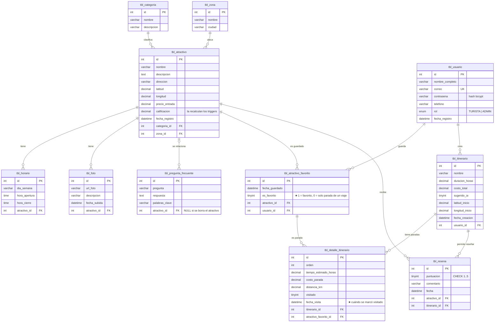

# Diagrama entidad-relación de CuscoSmart IA

Es el diseño original del grupo (11 tablas, 12 llaves foráneas) con **2 columnas agregadas** en las fases 11 y 12, marcadas con ★. GitHub dibuja el diagrama automáticamente.

## Reglas que hace cumplir la base

| Regla | Cómo |
| --- | --- |
| Un correo no se repite | `UNIQUE uq_usuario_correo` |
| No guardar dos veces el mismo favorito | `UNIQUE uq_favorito (usuario_id, atractivo_id)` |
| Una reseña por lugar en cada viaje | `UNIQUE uq_resena (itinerario_id, atractivo_id)` |
| Puntuación de 1 a 5 | `CHECK chk_resena_puntuacion` |
| Borrar un atractivo borra sus horarios, fotos, favoritos, paradas y reseñas | `ON DELETE CASCADE` |
| Borrar un atractivo NO borra sus preguntas frecuentes | `ON DELETE SET NULL` |
| Borrar un usuario borra sus favoritos y viajes | `ON DELETE CASCADE` |
| Solo se reseña lo visitado | trigger `trg_resena_valida` |
| La calificación del atractivo siempre al día | triggers `trg_resena_calificacion_ins` / `_del` |
| Distancias para ordenar la ruta | función `fn_distancia_km` (Haversine) |

## Las 2 columnas nuevas (★)

- **`tbl_atractivo_favorito.es_favorito`**: permite agregar a un viaje un lugar que no está en tus favoritos. La parada sigue apuntando a `tbl_atractivo_favorito`, como manda el diagrama; solo se marca con `0` para que no aparezca en "Favoritos".
- **`tbl_detalle_itinerario.fecha_visita`**: guarda cuándo marcaste la parada como visitada. Con ella se arma la línea de tiempo "Mi recorrido" del perfil.

Las dos tienen valor por defecto (`1`) o aceptan `NULL`, no cambian llaves ni cardinalidades y la base original sigue cargando sobre ellas. Se verificó con pruebas reales sobre la base (cascadas, `SET NULL`, llaves inválidas, `UNIQUE`, `CHECK` y triggers): todo correcto.
